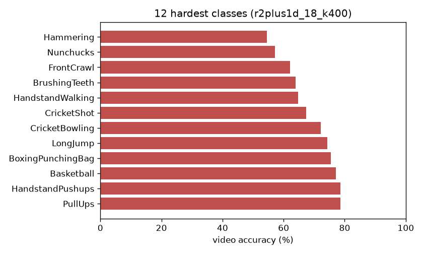
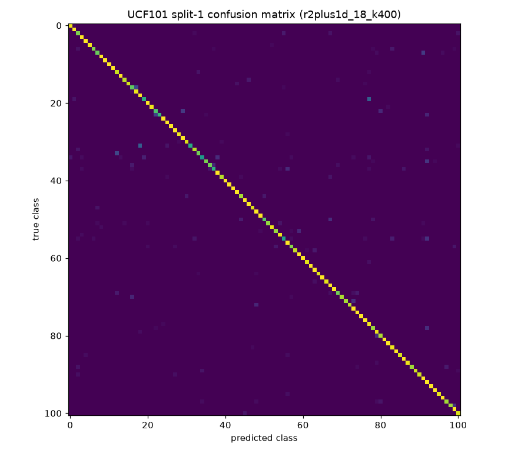

# Video Action Recognition on UCF101 with 3D CNNs

Fine-tuning spatio-temporal CNNs (**R(2+1)D-18** and **R3D-18**, Tran et al., CVPR 2018) on the real **UCF101** benchmark (101 human action classes, 13,320 YouTube videos). The comparison covers:
- factorised (2+1)D convolutions vs full 3D convolutions;
- Kinetics-400 pretraining vs training from scratch.

## Results: UCF101 split 1 (3,783 test videos)

| Model | Init | Clip top-1 | **Video top-1** | Video top-5 |
|---|---|---|---|---|
| R(2+1)D-18 | Kinetics-400 | 89.9 | **92.5** | 98.8 |
| R3D-18 | Kinetics-400 | 88.3 | 90.3 | 98.3 |
| R(2+1)D-18 | from scratch | 29.6 | 31.4 | 64.1 |

*Clip = a single 16-frame clip; video = scores averaged over 10 clips spaced uniformly across the video.*

**Findings:**
- **(2+1)D beats full 3D** by 2.2 points at a similar parameter count. Splitting each 3D kernel into a spatial 2D and a temporal 1D convolution adds a non-linearity and makes optimisation easier, as reported in the paper.
- **Pretraining dominates.** With the same 1-hour budget, the from-scratch model reaches only 31% (and was still improving, at 32% train accuracy). The Kinetics-initialised model reaches 92.5%. UCF101 (~9.5k training videos) is too small to learn good spatio-temporal features from scratch.
- **Multi-clip testing** adds 2–2.5 points over a single clip.
- 92.5% is in the expected range for an 18-layer R(2+1)D with Kinetics-400 pretraining at 112×112 and 16 frames.

<p align="center"></p>

### Error analysis (R(2+1)D-18, Kinetics init)

<p align="center"> </p>

The remaining errors are mostly between **fine-grained, visually similar actions**:

| True class | Predicted as | Test videos |
|---|---|---|
| BoxingPunchingBag | BoxingSpeedBag | 11 |
| BrushingTeeth | ShavingBeard | 11 |
| FrontCrawl | BreastStroke | 11 |
| CricketShot | CricketBowling | 10 |
| HammerThrow | ThrowDiscus | 7 |
| Haircut | BlowDryHair | 7 |

These pairs share the scene and body pose and differ only in a small object or a subtle motion pattern. That is a known weakness of low-resolution (112×112), short-clip 3D CNNs. The full list is in [`results/error_analysis.json`](results/error_analysis.json).

## Method

| | |
|---|---|
| Backbones | torchvision `r2plus1d_18` / `r3d_18`; new head = Dropout(0.5) + Linear(512 → 101) |
| Input | 16 frames, temporal stride 2 (~12.5 fps), resized to 128×171, random 112×112 crop + horizontal flip; Kinetics mean/std |
| Optimiser | SGD Nesterov (momentum 0.9, wd 5e-4), lr 0.0075, one-cycle cosine schedule, batch 8, label smoothing 0.1, AMP fp16 |
| Budget | fixed wall-clock budget: 1.75 h for R(2+1)D-18 Kinetics (14 epochs), 1 h for R3D-18 (14 epochs) and from scratch (7 epochs) |
| Test | 10 uniformly spaced clips per video, centre crop, softmax scores averaged |

Hardware: a single laptop RTX 500 Ada (4 GB). Videos are decoded on the fly with OpenCV, so no frame extraction is needed.

## Dataset

[UCF101](https://www.crcv.ucf.edu/data/UCF101.php), official split 1 (9,537 train / 3,783 test videos).

```bash
wget https://www.crcv.ucf.edu/data/UCF101/UCF101.rar && unrar x UCF101.rar
wget https://www.crcv.ucf.edu/data/UCF101/UCF101TrainTestSplits-RecognitionTask.zip && unzip UCF101TrainTestSplits-RecognitionTask.zip
export UCF101_ROOT=$PWD        # contains UCF-101/ and ucfTrainTestlist/
```

## Usage

```bash
pip install -r requirements.txt
python src/train.py --arch r2plus1d_18 --hours 1.75          # Kinetics-400 init
python src/train.py --arch r3d_18 --hours 1.0
python src/train.py --arch r2plus1d_18 --scratch --hours 1.0
python src/evaluate.py                                        # metrics, confusion matrix, error analysis
```

`--hours` measures the real throughput first and picks the number of epochs to fit the budget; use `--epochs N` for a fixed schedule.

## Repository layout

```
src/dataset.py    UCF101 loader (OpenCV decoding, train clip sampling, 10-clip test)
src/model.py      torchvision video backbones + new classification head
src/train.py      training loop (time budget, AMP, one-cycle)
src/evaluate.py   clip/video accuracy, confusion matrix, hardest classes
results/          metrics.json, error_analysis.json, histories, figures
```

## Author
Hessam Kaveh — Research Fellow, Italian Institute of Technology (IIT)

## License

Released under the [MIT License](LICENSE).
