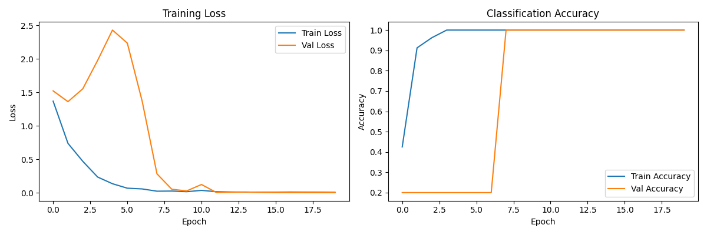

# Video Action Recognition with 3D CNN

3D Convolutional Neural Network for temporal action recognition in videos.
Classifies 5 action categories: Static, Slow Motion, Fast Motion, Rotation, Vibration.

**Data note:** this project uses a small procedurally generated (synthetic) dataset built in `src/dataset.py` (100 short clips of a moving square, 20 per class; the 5 classes differ only in motion pattern), not real images. It is a didactic implementation: the numbers below show that the pipeline trains, and are not comparable to benchmark results.

## Architecture
- **3D Convolutions**: Process both spatial (H×W) and temporal (T) dimensions
- **Multi-stage encoding**: 4 conv blocks with max pooling (spatial + temporal)
- **Global average pooling**: Aggregate temporal information
- **Classification head**: Fully connected layers

## Key Features
- **Permutation-invariant**: Learns temporal dynamics
- **GPU-optimized**: Efficient 3D convolution kernels
- **Dropout regularization**: Prevents overfitting on video sequences
- **Multi-scale temporal sampling**: Captures motion at different speeds

## Applications
- Robotics action understanding (robot arm motion classification)
- Autonomous systems (behavior monitoring)
- Video surveillance (action detection)
- Human activity recognition

## Installation
```bash
pip install -r requirements.txt
```

## Usage
```bash
python src/train.py
python src/evaluate.py
```

## Results

| Metric | Value |
|---|---|
| Validation accuracy, synthetic (20 clips) | 100 % |
| Epochs | 20 |

<p align="center"></p>

<p align="center"></p>

## Author
Hessam Kaveh — Research Fellow, Italian Institute of Technology (IIT)

## License

Released under the [MIT License](LICENSE).
